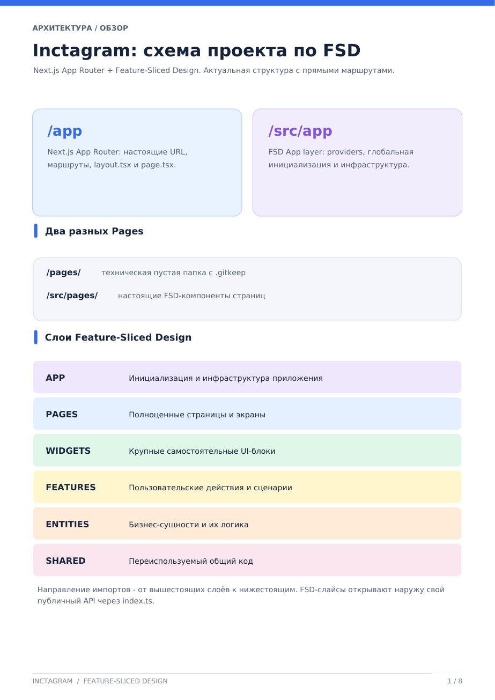
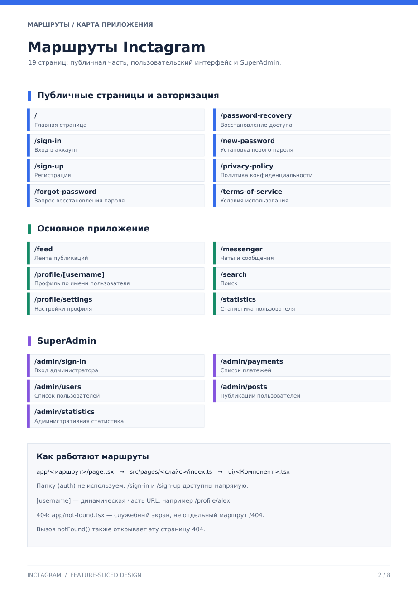
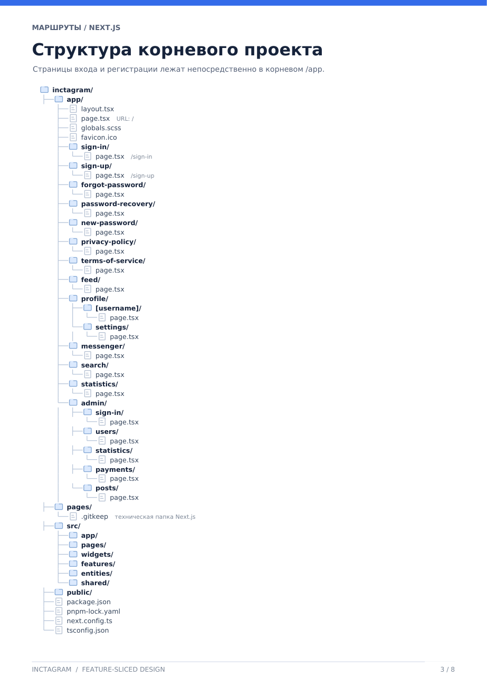
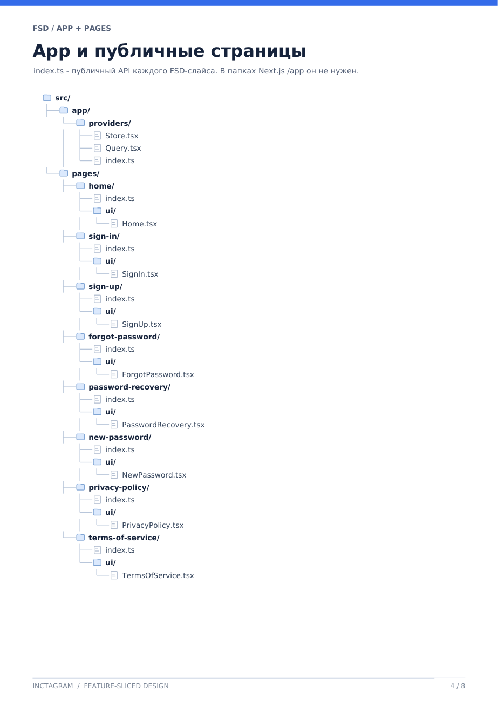
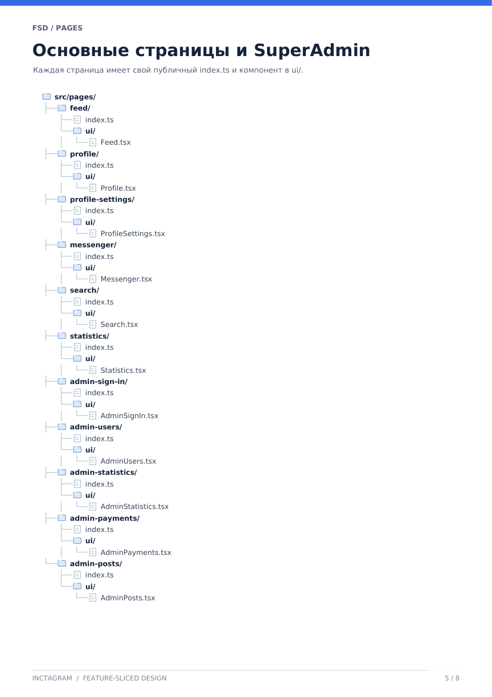
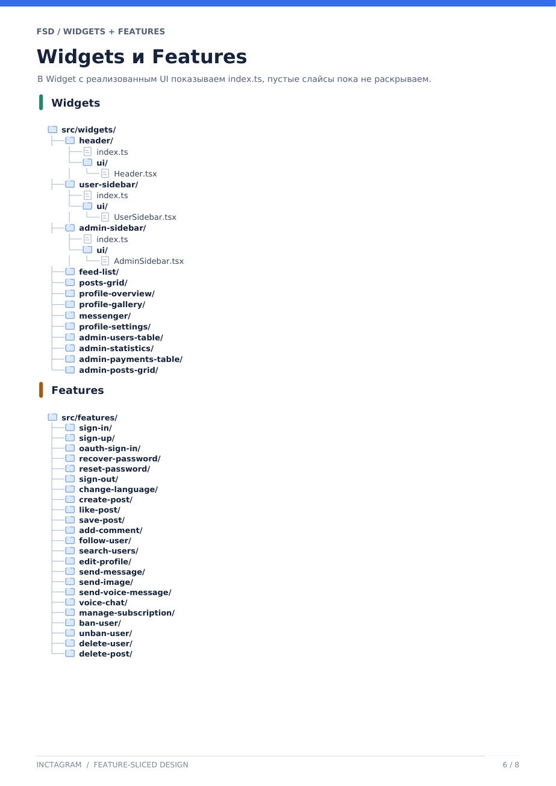
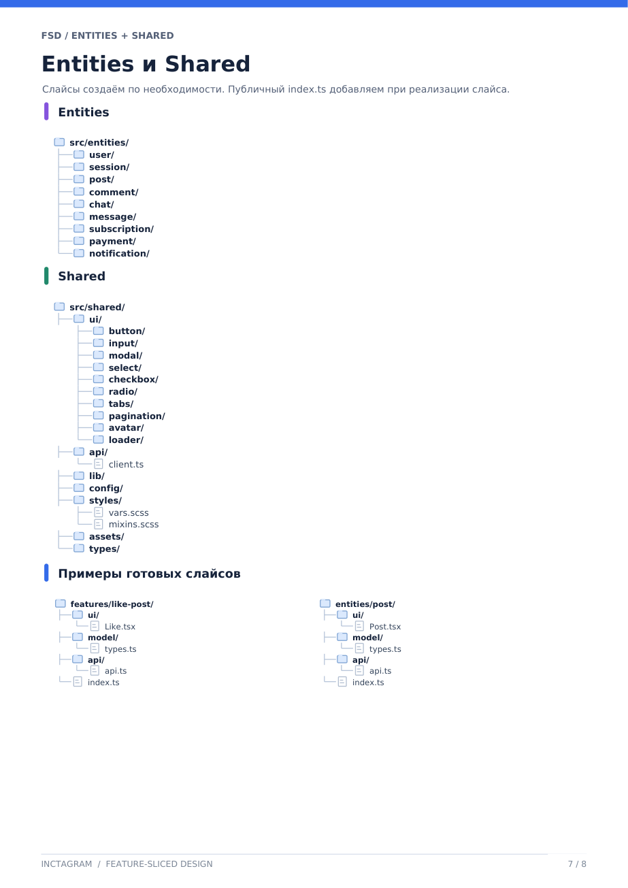
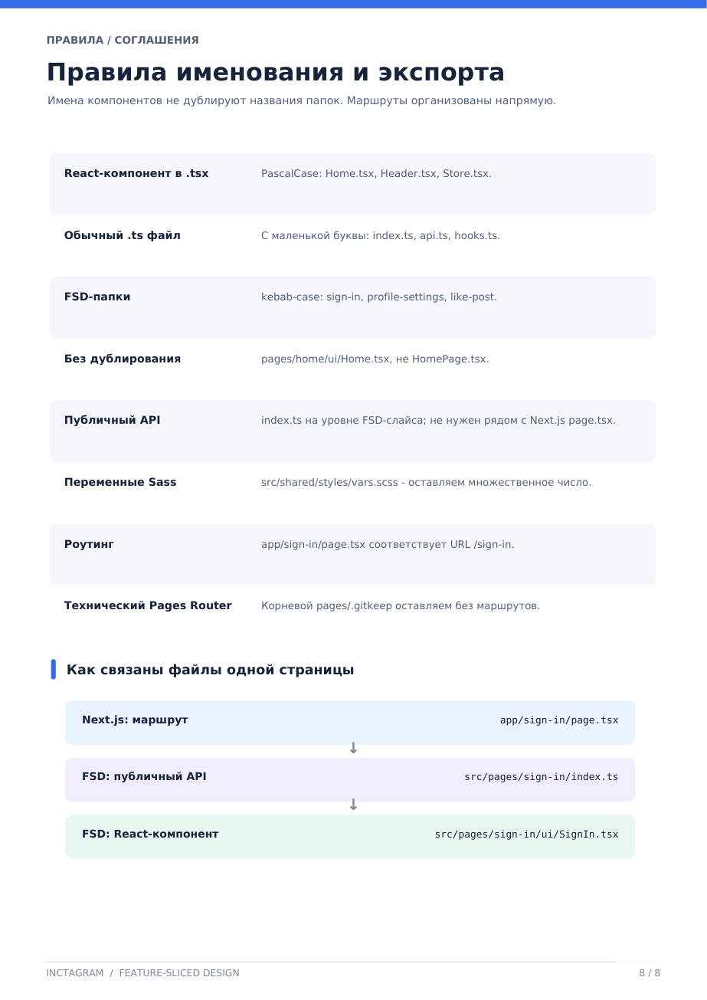

# Inctagram: схема проекта по FSD

**Next.js App Router + Feature-Sliced Design. Актуальная архитектурная схема с прямыми маршрутами.**

Документация архитектуры Inctagram: маршруты, слои FSD, правила именования и ссылки на README общих компонентов.

> **Как читать схемы:** наличие пути в дереве документации не гарантирует, что соответствующий модуль уже написан. По мере реализации обновляем документацию вместе с кодом.

## Содержание

-   [Стек и запуск](#стек-и-запуск)

1. [Архитектура / Обзор](#1-архитектура--обзор)
2. [Маршруты / Карта приложения](#2-маршруты--карта-приложения)
3. [Маршруты / Структура корневого проекта](#3-маршруты--структура-корневого-проекта)
4. [FSD / App и публичные страницы](#4-fsd--app-и-публичные-страницы)
5. [FSD / Основные страницы и SuperAdmin](#5-fsd--основные-страницы-и-superadmin)
6. [FSD / Widgets и Features](#6-fsd--widgets-и-features)
7. [FSD / Entities и Shared](#7-fsd--entities-и-shared)
8. [Правила / Именование и экспорт](#8-правила--именование-и-экспорт)
9. [Документация общих компонентов](#документация-общих-компонентов)

---

## Стек и запуск

| Часть             | Версия / инструмент                            |
| ----------------- | ---------------------------------------------- |
| Framework         | Next.js `16.3.8` (App Router)                  |
| UI                | React `19.2.8`, Sass, CSS Modules              |
| Язык              | TypeScript                                     |
| Данные / формы    | TanStack Query, Redux Toolkit, React Hook Form |
| Пакетный менеджер | pnpm `12.9.1`                                  |

```bash
pnpm install
pnpm dev
pnpm build
```

---

## 1. Архитектура / Обзор

### Inctagram: схема проекта по FSD

В проекте используются **Next.js App Router** для маршрутизации и **Feature-Sliced Design (FSD)** для организации прикладного кода. Важно различать совпадающие названия директорий на разных уровнях: `app` Next.js и `app` FSD — **не одно и то же**.

### Два разных `app`

| Каталог        | Роль                                                                                                |
| -------------- | --------------------------------------------------------------------------------------------------- |
| **`/app`**     | **Next.js App Router**: настоящие URL, маршруты, `layout.tsx`, `page.tsx` и глобальные точки входа. |
| **`/src/app`** | **FSD App layer**: провайдеры, глобальная инициализация и инфраструктура приложения.                |

### Два разных `pages`

| Каталог           | Роль                                                                        |
| ----------------- | --------------------------------------------------------------------------- |
| **`/pages/`**     | Техническая пустая папка с `.gitkeep`. Не используем её для маршрутов.      |
| **`/src/pages/`** | Настоящие FSD-компоненты страниц: композиция виджетов и функций приложения. |

### Слои Feature-Sliced Design

| Слой         | Назначение                                 |
| ------------ | ------------------------------------------ |
| **APP**      | Инициализация и инфраструктура приложения. |
| **PAGES**    | Полноценные страницы и экраны.             |
| **WIDGETS**  | Крупные самостоятельные UI-блоки.          |
| **FEATURES** | Пользовательские действия и сценарии.      |
| **ENTITIES** | Бизнес-сущности и их логика.               |
| **SHARED**   | Переиспользуемый общий код.                |

**Правило зависимостей:** направление импортов — **от вышестоящих слоёв к нижестоящим**. FSD-слайсы открывают наружу свой публичный API через `index.ts`.



---

## 2. Маршруты / Карта приложения

### Маршруты Inctagram

**19 страниц:** публичная часть, пользовательский интерфейс и SuperAdmin.

### Публичные страницы и авторизация

| URL                  | Назначение                    |
| -------------------- | ----------------------------- |
| `/`                  | Главная страница.             |
| `/sign-in`           | Вход в аккаунт.               |
| `/sign-up`           | Регистрация.                  |
| `/forgot-password`   | Запрос восстановления пароля. |
| `/password-recovery` | Восстановление доступа.       |
| `/new-password`      | Установка нового пароля.      |
| `/privacy-policy`    | Политика конфиденциальности.  |
| `/terms-of-service`  | Условия использования.        |

### Основное приложение

| URL                   | Назначение                     |
| --------------------- | ------------------------------ |
| `/feed`               | Лента публикаций.              |
| `/profile/[username]` | Профиль по имени пользователя. |
| `/profile/settings`   | Настройки профиля.             |
| `/messenger`          | Чаты и сообщения.              |
| `/search`             | Поиск.                         |
| `/statistics`         | Статистика пользователя.       |

### SuperAdmin

| URL                 | Назначение                   |
| ------------------- | ---------------------------- |
| `/admin/sign-in`    | Вход администратора.         |
| `/admin/users`      | Список пользователей.        |
| `/admin/statistics` | Административная статистика. |
| `/admin/payments`   | Список платежей.             |
| `/admin/posts`      | Публикации пользователей.    |

### Как работают маршруты

Связь URL и FSD-компонента:

```text
app/<маршрут>/page.tsx
        ↓
src/pages/<слайс>/index.ts
        ↓
src/pages/<слайс>/ui/<Компонент>.tsx
```

**Важные правила из схемы:**

-   Папку `(auth)` не используем: `/sign-in` и `/sign-up` доступны напрямую.
-   `[username]` — динамическая часть URL, например `/profile/alex`.
-   `app/not-found.tsx` — служебный экран **404**, не отдельный маршрут `/404`.
-   Вызов `notFound()` также открывает эту страницу 404.



---

## 3. Маршруты / Структура корневого проекта

### Структура корневого проекта

Страницы входа и регистрации лежат непосредственно в корневом `/app`. Ниже **полная структура корня**, без сокращения ветвей. Иконки 📁 и 📄 обозначают папки и файлы.

```text
📁 inctagram/
├── 📁 app/                              Next.js App Router
│   ├── 📄 layout.tsx
│   ├── 📄 page.tsx                      URL: /
│   ├── 📄 globals.scss
│   ├── 📄 favicon.ico
│   ├── 📁 sign-in/
│   │   └── 📄 page.tsx                  URL: /sign-in
│   ├── 📁 sign-up/
│   │   └── 📄 page.tsx                  URL: /sign-up
│   ├── 📁 forgot-password/
│   │   └── 📄 page.tsx                  URL: /forgot-password
│   ├── 📁 password-recovery/
│   │   └── 📄 page.tsx                  URL: /password-recovery
│   ├── 📁 new-password/
│   │   └── 📄 page.tsx                  URL: /new-password
│   ├── 📁 privacy-policy/
│   │   └── 📄 page.tsx                  URL: /privacy-policy
│   ├── 📁 terms-of-service/
│   │   └── 📄 page.tsx                  URL: /terms-of-service
│   ├── 📁 feed/
│   │   └── 📄 page.tsx                  URL: /feed
│   ├── 📁 profile/
│   │   ├── 📁 [username]/
│   │   │   └── 📄 page.tsx              URL: /profile/[username]
│   │   └── 📁 settings/
│   │       └── 📄 page.tsx              URL: /profile/settings
│   ├── 📁 messenger/
│   │   └── 📄 page.tsx                  URL: /messenger
│   ├── 📁 search/
│   │   └── 📄 page.tsx                  URL: /search
│   ├── 📁 statistics/
│   │   └── 📄 page.tsx                  URL: /statistics
│   └── 📁 admin/
│       ├── 📁 sign-in/
│       │   └── 📄 page.tsx              URL: /admin/sign-in
│       ├── 📁 users/
│       │   └── 📄 page.tsx              URL: /admin/users
│       ├── 📁 statistics/
│       │   └── 📄 page.tsx              URL: /admin/statistics
│       ├── 📁 payments/
│       │   └── 📄 page.tsx              URL: /admin/payments
│       └── 📁 posts/
│           └── 📄 page.tsx              URL: /admin/posts
├── 📁 pages/
│   └── 📄 .gitkeep                      Техническая папка Next.js
├── 📁 src/
│   ├── 📁 app/                          FSD: инициализация и providers
│   ├── 📁 pages/                        FSD: компоненты страниц
│   ├── 📁 widgets/
│   ├── 📁 features/
│   ├── 📁 entities/
│   └── 📁 shared/
├── 📁 public/
├── 📄 package.json
├── 📄 pnpm-lock.yaml
├── 📄 next.config.ts
└── 📄 tsconfig.json
```

Служебный `app/not-found.tsx` разобран отдельно в разделе [о маршрутах](#2-маршруты--карта-приложения): он не входит в 19 обычных URL.



---

## 4. FSD / App и публичные страницы

### App и публичные страницы

`index.ts` — публичный API каждого **FSD-слайса**. В папках Next.js `/app` он не нужен.

В каталоге `src/app/providers/` предусмотрены провайдеры приложения. Публичные страницы расположены в `src/pages/`, каждая в собственном слайсе.

```text
📁 src/
├── 📁 app/
│   └── 📁 providers/
│       ├── 📄 QueryProvider.tsx
│       └── 📄 index.ts
└── 📁 pages/
    ├── 📁 home/
    │   ├── 📄 index.ts
    │   └── 📁 ui/
    │       └── 📄 Home.tsx
    ├── 📁 sign-in/
    │   ├── 📄 index.ts
    │   └── 📁 ui/
    │       └── 📄 SignIn.tsx
    ├── 📁 sign-up/
    │   ├── 📄 index.ts
    │   └── 📁 ui/
    │       └── 📄 SignUp.tsx
    ├── 📁 forgot-password/
    │   ├── 📄 index.ts
    │   └── 📁 ui/
    │       └── 📄 ForgotPassword.tsx
    ├── 📁 password-recovery/
    │   ├── 📄 index.ts
    │   └── 📁 ui/
    │       └── 📄 PasswordRecovery.tsx
    ├── 📁 new-password/
    │   ├── 📄 index.ts
    │   └── 📁 ui/
    │       └── 📄 NewPassword.tsx
    ├── 📁 privacy-policy/
    │   ├── 📄 index.ts
    │   └── 📁 ui/
    │       └── 📄 PrivacyPolicy.tsx
    └── 📁 terms-of-service/
        ├── 📄 index.ts
        └── 📁 ui/
            └── 📄 TermsOfService.tsx
```



---

## 5. FSD / Основные страницы и SuperAdmin

### Основные страницы и SuperAdmin

Каждая страница имеет собственный публичный `index.ts` и React-компонент в папке `ui/`.

```text
📁 src/pages/
├── 📁 feed/
│   ├── 📄 index.ts
│   └── 📁 ui/
│       └── 📄 Feed.tsx
├── 📁 profile/
│   ├── 📄 index.ts
│   └── 📁 ui/
│       └── 📄 Profile.tsx
├── 📁 profile-settings/
│   ├── 📄 index.ts
│   └── 📁 ui/
│       └── 📄 ProfileSettings.tsx
├── 📁 messenger/
│   ├── 📄 index.ts
│   └── 📁 ui/
│       └── 📄 Messenger.tsx
├── 📁 search/
│   ├── 📄 index.ts
│   └── 📁 ui/
│       └── 📄 Search.tsx
├── 📁 statistics/
│   ├── 📄 index.ts
│   └── 📁 ui/
│       └── 📄 Statistics.tsx
├── 📁 admin-sign-in/
│   ├── 📄 index.ts
│   └── 📁 ui/
│       └── 📄 AdminSignIn.tsx
├── 📁 admin-users/
│   ├── 📄 index.ts
│   └── 📁 ui/
│       └── 📄 AdminUsers.tsx
├── 📁 admin-statistics/
│   ├── 📄 index.ts
│   └── 📁 ui/
│       └── 📄 AdminStatistics.tsx
├── 📁 admin-payments/
│   ├── 📄 index.ts
│   └── 📁 ui/
│       └── 📄 AdminPayments.tsx
└── 📁 admin-posts/
    ├── 📄 index.ts
    └── 📁 ui/
        └── 📄 AdminPosts.tsx
```



---

## 6. FSD / Widgets и Features

### Widgets и Features

В **Widget с реализованным UI** показываем `index.ts` и `ui/` с компонентом. Пустые слайсы пока не раскрываем.

### Widgets

```text
📁 src/widgets/
├── 📁 header/
│   ├── 📄 index.ts
│   └── 📁 ui/
│       └── 📄 Header.tsx
├── 📁 user-sidebar/
│   ├── 📄 index.ts
│   └── 📁 ui/
│       └── 📄 UserSidebar.tsx
├── 📁 admin-sidebar/
│   ├── 📄 index.ts
│   └── 📁 ui/
│       └── 📄 AdminSidebar.tsx
├── 📁 feed-list/
├── 📁 posts-grid/
├── 📁 profile-overview/
├── 📁 profile-gallery/
├── 📁 messenger/
├── 📁 profile-settings/
├── 📁 admin-users-table/
├── 📁 admin-statistics/
├── 📁 admin-payments-table/
└── 📁 admin-posts-grid/
```

### Features

```text
📁 src/features/
├── 📁 sign-in/
├── 📁 sign-up/
├── 📁 oauth/
├── 📁 recover-password/
├── 📁 reset-password/
├── 📁 sign-out/
├── 📁 change-language/
├── 📁 create-post/
├── 📁 like-post/
├── 📁 save-post/
├── 📁 add-comment/
├── 📁 follow-user/
├── 📁 search-users/
├── 📁 edit-profile/
├── 📁 send-message/
├── 📁 send-image/
├── 📁 send-voice-message/
├── 📁 voice-chat/
├── 📁 manage-subscription/
├── 📁 ban-user/
├── 📁 unban-user/
├── 📁 delete-user/
└── 📁 delete-post/
```

> Имена выше — перечень слайсов из архитектурной схемы, а не заявление о готовности всех функций. Слайс OAuth в коде называется `oauth/` (не `oauth-sign-in/`).



---

## 7. FSD / Entities и Shared

### Entities и Shared

**Слайсы создаём по необходимости.** Публичный `index.ts` добавляем при реализации слайса.

### Entities

```text
📁 src/entities/
├── 📁 user/
├── 📁 session/
├── 📁 post/
├── 📁 comment/
├── 📁 chat/
├── 📁 message/
├── 📁 subscription/
├── 📁 payment/
└── 📁 notification/
```

### Shared

```text
📁 src/shared/
├── 📁 ui/
│   ├── 📁 button/
│   ├── 📁 input/
│   ├── 📁 textarea/
│   ├── 📁 modal/
│   ├── 📁 select/
│   ├── 📁 checkbox/
│   ├── 📁 date-picker/
│   ├── 📁 radio/
│   ├── 📁 tabs/
│   ├── 📁 pagination/
│   ├── 📁 avatar/
│   └── 📁 loader/
├── 📁 api/
│   └── 📄 instance.ts
├── 📁 lib/
├── 📁 config/
├── 📁 styles/
│   ├── 📄 reset.css
│   └── 📄 vars.scss
├── 📁 assets/
└── 📁 types/
```

**Общие UI-компоненты, уже подготовленные в проекте:** `Button`, `Checkbox`, `DatePicker` и `DateRangePicker`, `Input`, `Modal`, `Select`, `Tabs`, `Textarea`. Их подробное описание и примеры использования вынесены в [собственные README](#документация-общих-компонентов). Остальные названия в дереве — элементы целевой схемы и не означают, что компоненты уже реализованы.

### Примеры готовых слайсов

Это **примеры структуры FSD-слайсов**, а не утверждение, что соответствующие реализации уже присутствуют в репозитории.

**Feature: `like-post/`**

```text
📁 src/features/like-post/
├── 📁 ui/
│   └── 📄 Like.tsx
├── 📁 model/
│   └── 📄 types.ts
├── 📁 api/
│   └── 📄 api.ts
└── 📄 index.ts
```

**Entity: `post/`**

```text
📁 src/entities/post/
├── 📁 ui/
│   └── 📄 Post.tsx
├── 📁 model/
│   └── 📄 types.ts
├── 📁 api/
│   └── 📄 api.ts
└── 📄 index.ts
```



---

## 8. Правила / Именование и экспорт

### Правила именования и экспорта

Имена компонентов не дублируют названия папок. Маршруты организованы напрямую.

| Правило                      | Соглашение                                                     | Пример                                           |
| ---------------------------- | -------------------------------------------------------------- | ------------------------------------------------ |
| **React-компонент в `.tsx`** | `PascalCase`.                                                  | `Home.tsx`, `Header.tsx`, `QueryProvider.tsx`.   |
| **Обычный `.ts` файл**       | С маленькой буквы.                                             | `index.ts`, `api.ts`, `hooks.ts`.                |
| **FSD-папки**                | `kebab-case`.                                                  | `sign-in`, `profile-settings`, `like-post`.      |
| **Без дублирования имени**   | Имя компонента не расширяем названием папки без необходимости. | `pages/home/ui/Home.tsx`, **не** `HomePage.tsx`. |
| **Публичный API**            | `index.ts` на уровне FSD-слайса.                               | Не нужен рядом с Next.js `page.tsx`.             |
| **Переменные Sass**          | Оставляем множественное число в имени файла.                   | `src/shared/styles/vars.scss`.                   |
| **Роутинг**                  | Прямые маршруты в Next.js.                                     | `app/sign-in/page.tsx` → `/sign-in`.             |
| **Технический Pages Router** | Корневую пустую папку сохраняем.                               | `pages/.gitkeep`, без маршрутов.                 |

### Как связаны файлы одной страницы

```text
🌐 Next.js: маршрут
   app/sign-in/page.tsx
             ↓
📦 FSD: публичный API
   src/pages/sign-in/index.ts
             ↓
📄 FSD: React-компонент
   src/pages/sign-in/ui/SignIn.tsx
```

Файл маршрута подключает страницу через публичный API FSD-слайса. Сам React-компонент находится внутри `ui/` этого слайса.



---

## Документация общих компонентов

Общие переиспользуемые элементы интерфейса находятся в `src/shared/ui/`. На текущем этапе у следующих компонентов есть собственная подробная документация:

| Компонент                       | Расположение                 | Подробная документация                                   |
| ------------------------------- | ---------------------------- | -------------------------------------------------------- |
| **Button**                      | `src/shared/ui/button/`      | [README Button](src/shared/ui/button/README.md)          |
| **Checkbox**                    | `src/shared/ui/checkbox/`    | [README Checkbox](src/shared/ui/checkbox/README.md)      |
| **DatePicker, DateRangePicker** | `src/shared/ui/date-picker/` | [README DatePicker](src/shared/ui/date-picker/README.md) |
| **Input**                       | `src/shared/ui/input/`       | [README Input](src/shared/ui/input/README.md)            |
| **Modal**                       | `src/shared/ui/modal/`       | [README Modal](src/shared/ui/modal/README.md)            |
| **Select**                      | `src/shared/ui/select/`      | [README Select](src/shared/ui/select/README.md)          |
| **Tabs**                        | `src/shared/ui/tabs/`        | [README Tabs](src/shared/ui/tabs/README.md)              |
| **Textarea**                    | `src/shared/ui/textarea/`    | [README Textarea](src/shared/ui/textarea/README.md)      |

Для их использования импортируем компоненты через публичные API соответствующих папок (`index.ts`). Подробные props, состояния, примеры и интеграцию с React Hook Form **не дублируем здесь** — они описаны в README каждого компонента.

### Другие документы проекта

_Источник архитектурных схем и деревьев: `inctagram-fsd-v3(1).pdf` (8 страниц). Изображения каждой страницы включены рядом с соответствующим текстовым разделом. Корневой README — основная текстовая документация архитектуры; PDF хранить в репозитории необязательно._

-   [TanStack Query — настройка и использование](docs/tanstack-query.md).
-   [API — axios instance, access token, переменные окружения](docs/api.md).
-   [Вход в систему (Sign In) — бизнес-логика и структура слайсов](docs/sign-in.md).
-   [General Information — форма настроек профиля и фото профиля](docs/general-information.md).
