# Modal

Универсальное модальное окно для интерфейса Inctagram.

## Назначение

`Modal` — общий UI-компонент для всех всплывающих окон проекта: уведомления, подтверждения действий, списки подписчиков, загрузка фото, создание, редактирование и просмотр поста.

Компонент лежит в слое `shared` архитектуры FSD, потому что это переиспользуемый элемент без привязки к конкретной фиче. Его можно импортировать из любого слоя выше: `features`, `widgets`, `pages`.

Сам `Modal` отвечает только за окно: затемнение фона, рамку, шапку, крестик, ряд кнопок, закрытие и блокировку прокрутки страницы. Текст, формы, списки и запросы к серверу размещай снаружи, в фиче. Так же устроены `Input`, `Textarea` и `DatePicker`.

Окно построено на нативном теге `<dialog>`. Браузер сам показывает его поверх страницы, затемняет фон и держит фокус внутри окна.

## Импорт

```tsx
import { Modal } from '@/shared/ui/modal';
```

Импортируй только через публичный API слайса (`index.ts`). Не пиши пути вида `@/shared/ui/modal/ui/Modal`: внутреннее устройство папки может измениться, а публичный экспорт останется стабильным.

## Свойства (Props)

| Prop                  | Тип                  | По умолчанию | Назначение                                                 |
| --------------------- | -------------------- | ------------ | ---------------------------------------------------------- |
| `open`                | `boolean`            | —            | Открыто ли окно (обязательный)                             |
| `onClose`             | `() => void`         | —            | Вызывается при любой попытке закрыть окно (обязательный)   |
| `children`            | `ReactNode`          | —            | Содержимое окна (обязательный)                             |
| `title`               | `string`             | —            | Заголовок. Если передан, рисуется шапка                    |
| `width`               | `number`             | `378`        | Ширина окна в пикселях                                     |
| `closeOnOverlayClick` | `boolean`            | `true`       | Закрывать ли окно кликом по затемнённому фону              |
| `headerLeft`          | `ReactNode`          | —            | Слева в шапке, например стрелка «назад»                    |
| `headerRight`         | `ReactNode`          | —            | Справа в шапке **вместо крестика**, например кнопка `Next` |
| `noPadding`           | `boolean`            | `false`      | Тело без отступов: фото прилегает к краям окна             |
| `actions`             | `ReactNode`          | —            | Ряд кнопок внизу окна                                      |
| `actionsAlign`        | `'end' \| 'between'` | `'end'`      | Кнопки прижаты вправо или разнесены по краям               |
| `closeOutside`        | `boolean`            | `false`      | Крестик снаружи окна, в правом верхнем углу экрана         |

`headerLeft`, `headerRight`, `noPadding`, `actions` и `actionsAlign` работают только вместе с `title`: это части шапки и тела стандартного окна.

Окно управляемое (controlled): открыто оно или нет, хранит родитель в `useState`. `Modal` сам себя не закрывает, он только вызывает `onClose`. Родитель решает, что делать: закрыть окно, показать подтверждение «Точно закрыть?» или ничего не делать.

## Как закрывается окно

| Способ                           | Что происходит                                                    |
| -------------------------------- | ----------------------------------------------------------------- |
| Крестик в шапке или снаружи окна | вызывается `onClose`                                              |
| Клавиша Escape                   | вызывается `onClose`                                              |
| Клик по затемнённому фону        | вызывается `onClose`, если `closeOnOverlayClick` не равен `false` |
| Кнопки в окне (OK, Yes, No)      | обработчики пишет фича, обычно они тоже закрывают окно            |

## Как выглядит шапка

| Что передать                               | Шапка                                                                           |
| ------------------------------------------ | ------------------------------------------------------------------------------- |
| `title`                                    | заголовок слева, крестик справа, линия снизу                                    |
| `title` + `headerLeft` и/или `headerRight` | `headerLeft` слева, заголовок **по центру**, `headerRight` справа. Крестика нет |
| `title` + `closeOutside`                   | заголовок без крестика, крестик снаружи окна                                    |
| без `title`                                | шапки нет, только рамка и фон. Отступов тоже нет, всё рисует фича               |

## Use-cases из макета

Ниже собраны все модальные окна из Figma (вкладки `WebApp / UI / Auth`, `WebApp / UI`, `WebApp / UI / SuperAdmin`) и готовая реализация каждого. Картинки лежат в папке [`images`](./images).

Во всех примерах размеры вынесены в константы: в проекте включено правило `no-magic-numbers`.

### 1. Уведомление с одной кнопкой

Окно сообщает о результате действия. Одна кнопка закрывает окно.

| Email sent                             | Success                                          | Error                                        |
| -------------------------------------- | ------------------------------------------------ | -------------------------------------------- |
| 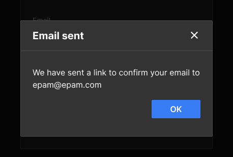 | 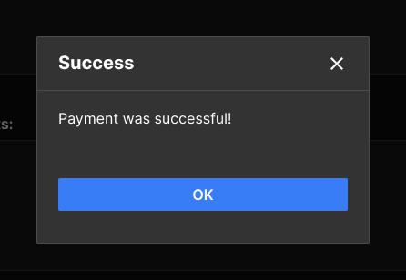 | 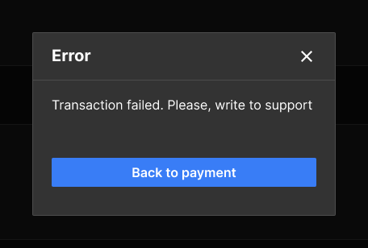 |
| Sign Up, Forgot Password               | Account Management                               | Account Management                           |

**Email sent** — кнопка справа:

```tsx
'use client';

import { Button } from '@/shared/ui/button';
import { Modal } from '@/shared/ui/modal';

type EmailSentModalProps = {
    open: boolean;
    email: string;
    onClose: () => void;
};

export const EmailSentModal = ({
    open,
    email,
    onClose,
}: EmailSentModalProps): React.JSX.Element => {
    return (
        <Modal
            open={open}
            onClose={onClose}
            title="Email sent"
            actions={<Button onClick={onClose}>OK</Button>}
        >
            <p>We have sent a link to confirm your email to {email}</p>
        </Modal>
    );
};
```

Подключение в форме: окно открывается после успешного запроса.

```tsx
const [isEmailSentOpen, setIsEmailSentOpen] = useState(false);

// в onSuccess запроса регистрации
setIsEmailSentOpen(true);

<EmailSentModal
    open={isEmailSentOpen}
    email={email}
    onClose={() => setIsEmailSentOpen(false)}
/>;
```

**Success и Error оплаты** — кнопка во всю ширину, для этого у `Button` есть `fullWidth`:

```tsx
<Modal
    open={isSuccessOpen}
    onClose={closeSuccess}
    title="Success"
    actions={
        <Button fullWidth onClick={closeSuccess}>
            OK
        </Button>
    }
>
    <p>Payment was successful!</p>
</Modal>

<Modal
    open={isErrorOpen}
    onClose={closeError}
    title="Error"
    actions={
        <Button fullWidth onClick={closeError}>
            Back to payment
        </Button>
    }
>
    <p>Transaction failed. Please, write to support</p>
</Modal>
```

### 2. Подтверждение Yes / No

Окно спрашивает «вы уверены?». `Yes` выполняет действие, `No` закрывает окно. Кнопки прижаты вправо.

| Log Out                          | Delete Photo                               |
| -------------------------------- | ------------------------------------------ |
| 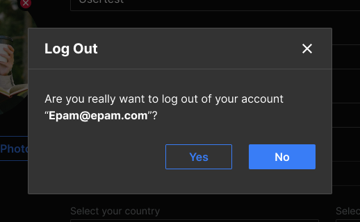 | 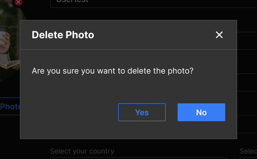 |

| Unfollow                           | Delete Following                                   |
| ---------------------------------- | -------------------------------------------------- |
| 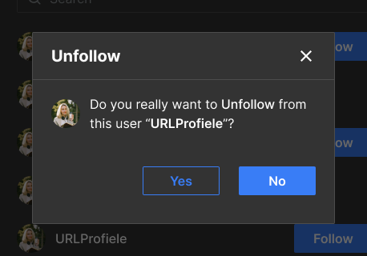 | 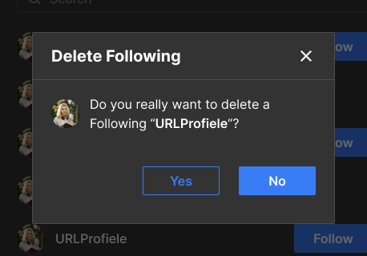 |

| Delete Post                              | Close Post                             |
| ---------------------------------------- | -------------------------------------- |
| 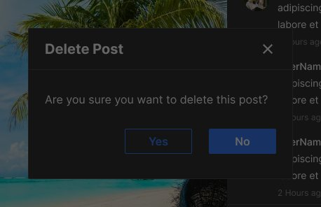 | 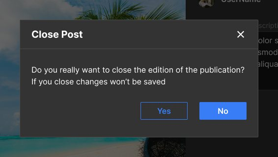 |

| Delete user (SuperAdmin)                 |
| ---------------------------------------- |
| 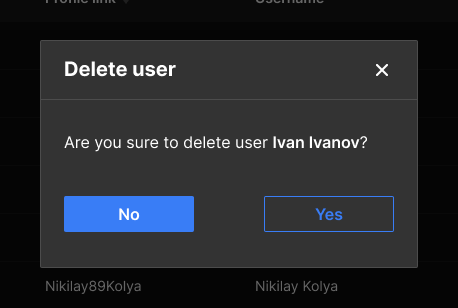 |

Реализация на примере **Log Out**:

```tsx
'use client';

import { Button } from '@/shared/ui/button';
import { Modal } from '@/shared/ui/modal';

const LOG_OUT_MODAL_WIDTH = 438;

type LogOutModalProps = {
    open: boolean;
    email: string;
    onConfirm: () => void;
    onClose: () => void;
};

export const LogOutModal = ({
    open,
    email,
    onConfirm,
    onClose,
}: LogOutModalProps): React.JSX.Element => {
    return (
        <Modal
            open={open}
            onClose={onClose}
            title="Log Out"
            width={LOG_OUT_MODAL_WIDTH}
            actions={
                <>
                    <Button variant="outlined" onClick={onConfirm}>
                        Yes
                    </Button>
                    <Button onClick={onClose}>No</Button>
                </>
            }
        >
            <p>
                Are you really want to log out of your account <b>“{email}”</b>?
            </p>
        </Modal>
    );
};
```

Остальные окна этой группы устроены так же, отличаются только заголовком, текстом и шириной:

| Окно             | `title`            | Текст                                                                                           | `width` |
| ---------------- | ------------------ | ----------------------------------------------------------------------------------------------- | ------- |
| Log Out          | `Log Out`          | Are you really want to log out of your account “…”?                                             | 438     |
| Delete Photo     | `Delete Photo`     | Are you sure you want to delete the photo?                                                      | 438     |
| Unfollow         | `Unfollow`         | Do you really want to Unfollow from this user “…”?                                              | 378     |
| Delete Following | `Delete Following` | Do you really want to delete a Following “…”?                                                   | 378     |
| Delete Post      | `Delete Post`      | Are you sure you want to delete this post?                                                      | 378     |
| Close Post       | `Close Post`       | Do you really want to close the edition of the publication? If you close changes won’t be saved | 486     |
| Delete user      | `Delete user`      | Are you sure to delete user …?                                                                  | 378     |

#### Окно поверх окна

`Delete Post`, `Close Post`, `Unfollow` и `Delete Following` открываются **поверх другого окна** (пост, редактирование, список). Второй `<dialog>` встаёт над первым, Escape закрывает только верхний.

Окно подтверждения рендери **рядом** с первым, а не внутри его `children`. Иначе нажатие Escape во втором окне «всплывёт» в первое, и закроются оба.

```tsx
const [isPostOpen, setIsPostOpen] = useState(false);
const [isDeletePostOpen, setIsDeletePostOpen] = useState(false);

const closeDeletePost = (): void => setIsDeletePostOpen(false);

const deletePost = (): void => {
    // запрос на удаление поста
    setIsDeletePostOpen(false);
    setIsPostOpen(false);
};

<>
    <Modal
        open={isPostOpen}
        onClose={() => setIsPostOpen(false)}
        width={POST_MODAL_WIDTH}
        closeOutside
    >
        <Post onDeleteClick={() => setIsDeletePostOpen(true)} />
    </Modal>

    <Modal
        open={isDeletePostOpen}
        onClose={closeDeletePost}
        title="Delete Post"
        actions={
            <>
                <Button variant="outlined" onClick={deletePost}>
                    Yes
                </Button>
                <Button onClick={closeDeletePost}>No</Button>
            </>
        }
    >
        <p>Are you sure you want to delete this post?</p>
    </Modal>
</>;
```

> В макете `Delete Post` затемнён вместе с постом: в Figma слой затемнения лежит выше окна. Это неточность макета, само окно должно быть ярким, как `Close Post`.

### 3. Подтверждение, где кнопки разнесены по краям

В `Un-Ban user` и `Ban user` (SuperAdmin) кнопки `No` и `Yes` стоят по разным краям окна. Для этого `actionsAlign="between"`.

| Un-Ban user                              | Ban user                           | Ban user, список причин открыт                   |
| ---------------------------------------- | ---------------------------------- | ------------------------------------------------ |
| 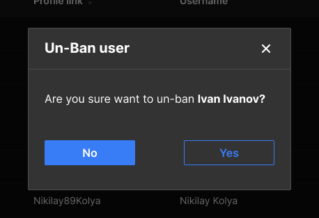 | 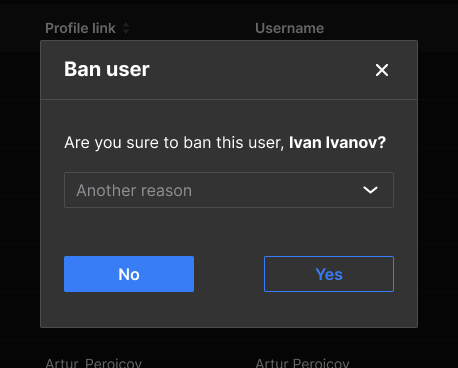 | 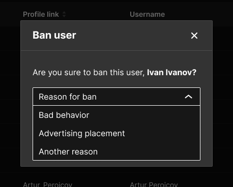 |

```tsx
'use client';

import { Button } from '@/shared/ui/button';
import { Modal } from '@/shared/ui/modal';

import css from './banUserModal.module.scss';

type BanUserModalProps = {
    open: boolean;
    userName: string;
    onConfirm: () => void;
    onClose: () => void;
};

export const BanUserModal = ({
    open,
    userName,
    onConfirm,
    onClose,
}: BanUserModalProps): React.JSX.Element => {
    return (
        <Modal
            open={open}
            onClose={onClose}
            title="Ban user"
            actionsAlign="between"
            actions={
                <>
                    <Button onClick={onClose}>No</Button>
                    <Button variant="outlined" onClick={onConfirm}>
                        Yes
                    </Button>
                </>
            }
        >
            <p>
                Are you sure to ban this user, <b>{userName}?</b>
            </p>
            {/* Общего Select пока нет, временно нативный select */}
            <select className={css.select} defaultValue="" aria-label="Reason for ban">
                <option value="" disabled>
                    Reason for ban
                </option>
                <option value="bad-behavior">Bad behavior</option>
                <option value="advertising">Advertising placement</option>
                <option value="another">Another reason</option>
            </select>
        </Modal>
    );
};
```

```scss
/* banUserModal.module.scss */
.select {
    width: 100%;
    height: 36px;
    margin-top: 18px;
    border: 1px solid #4c4c4c;
    background-color: #333;
    color: #fff;
}
```

`Un-Ban user` такой же, только без `select` и с текстом `Are you sure want to un-ban …?`.

### 4. Чекбокс или вторая кнопка слева

В ряду кнопок слева стоит чекбокс или вторая кнопка. Тоже `actionsAlign="between"`: первый элемент из `actions` встаёт к левому краю, последний к правому.

| Create payment                                 | Close (выход из создания поста)          |
| ---------------------------------------------- | ---------------------------------------- |
| 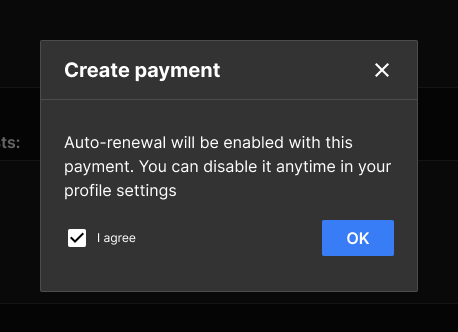 | 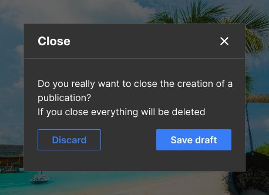 |

**Create payment** — `OK` активна только после галочки:

```tsx
/* eslint-disable jsx-a11y/label-has-associated-control */

'use client';

import { useState } from 'react';

import { Button } from '@/shared/ui/button';
import { Checkbox } from '@/shared/ui/checkbox';
import { Modal } from '@/shared/ui/modal';

import css from './createPaymentModal.module.scss';

type CreatePaymentModalProps = {
    open: boolean;
    onConfirm: () => void;
    onClose: () => void;
};

export const CreatePaymentModal = ({
    open,
    onConfirm,
    onClose,
}: CreatePaymentModalProps): React.JSX.Element => {
    const [isAgree, setIsAgree] = useState(false);

    return (
        <Modal
            open={open}
            onClose={onClose}
            title="Create payment"
            actionsAlign="between"
            actions={
                <>
                    <div className={css.agree}>
                        <Checkbox
                            id="agree"
                            checked={isAgree}
                            onChange={event => setIsAgree(event.target.checked)}
                        />
                        <label htmlFor="agree">I agree</label>
                    </div>
                    <Button disabled={!isAgree} onClick={onConfirm}>
                        OK
                    </Button>
                </>
            }
        >
            <p>
                Auto-renewal will be enabled with this payment. You can disable it anytime
                in your profile settings
            </p>
        </Modal>
    );
};
```

```scss
/* createPaymentModal.module.scss */
.agree {
    display: flex;
    align-items: center;
    font-size: 14px;
}
```

Отключение правила `label-has-associated-control` в первой строке такое же, как в формах `sign-in` и `sign-up`: линтер не видит, что `Checkbox` внутри — это `<input>`.

**Close** — открывается поверх окна создания поста (раздел 7), когда пользователь пытается его закрыть:

```tsx
<Modal
    open={isCloseConfirmOpen}
    onClose={() => setIsCloseConfirmOpen(false)}
    title="Close"
    actionsAlign="between"
    actions={
        <>
            <Button variant="outlined" onClick={discardPost}>
                Discard
            </Button>
            <Button onClick={saveDraft}>Save draft</Button>
        </>
    }
>
    <p>
        Do you really want to close the creation of a publication?
        <br />
        If you close everything will be deleted
    </p>
</Modal>
```

### 5. Список пользователей

Окна со списком подписчиков, подписок и лайков. Ширина 644px, стандартная шапка, внутри поиск и список. Кнопок внизу нет.

| Followers                            | Following                            | Likes                        |
| ------------------------------------ | ------------------------------------ | ---------------------------- |
| 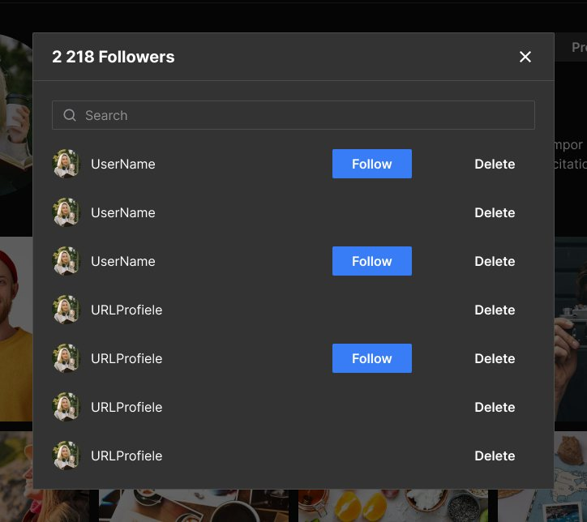 | 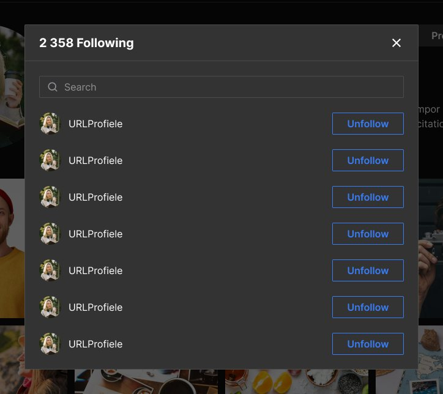 | 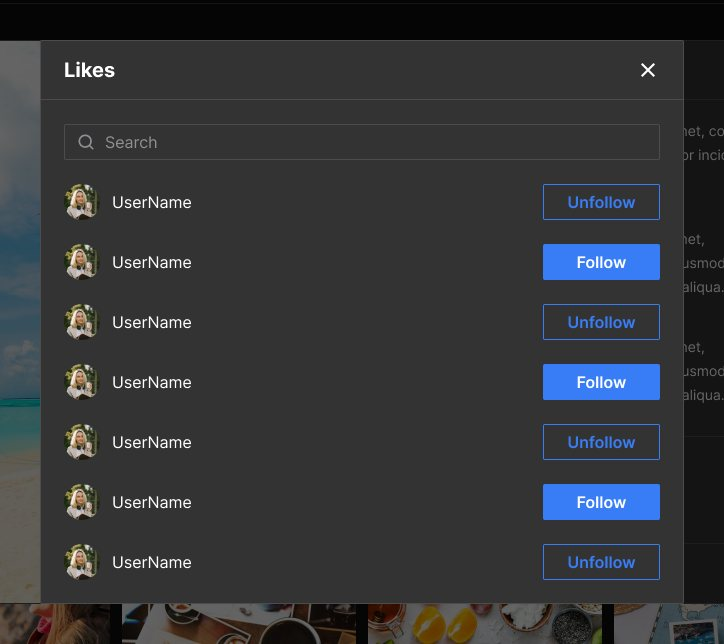 |

```tsx
'use client';

import { Input } from '@/shared/ui/input';
import { Modal } from '@/shared/ui/modal';

import css from './followersModal.module.scss';

const USERS_MODAL_WIDTH = 644;

type FollowersModalProps = {
    open: boolean;
    count: number;
    onClose: () => void;
};

export const FollowersModal = ({
    open,
    count,
    onClose,
}: FollowersModalProps): React.JSX.Element => {
    return (
        <Modal
            open={open}
            onClose={onClose}
            title={`${count} Followers`}
            width={USERS_MODAL_WIDTH}
        >
            <Input className={css.search} type="search" placeholder="Search" />
            {/* Строки списка: аватар, имя, кнопки Follow / Delete */}
            <FollowersList />
        </Modal>
    );
};
```

```scss
/* followersModal.module.scss */
.search {
    margin-bottom: 12px;
}
```

-   `Following` — то же окно с заголовком `… Following` и кнопками `Unfollow`.
-   `Likes` — заголовок `Likes`, кнопки `Follow`.
-   `Delete` и `Unfollow` в строке открывают подтверждение из раздела 2 **поверх** списка.

### 6. Загрузка фото

Ширина 492px, стандартная шапка. В теле заглушка картинки и кнопки выбора файла. Ошибка формата или размера показывается внутри окна.

| Add Photo (новый пост)                     | Add a Profile Photo, ошибка                                        | Add a Profile Photo, фото выбрано                                |
| ------------------------------------------ | ------------------------------------------------------------------ | ---------------------------------------------------------------- |
| 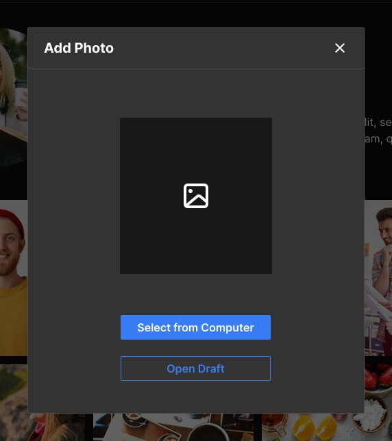 | 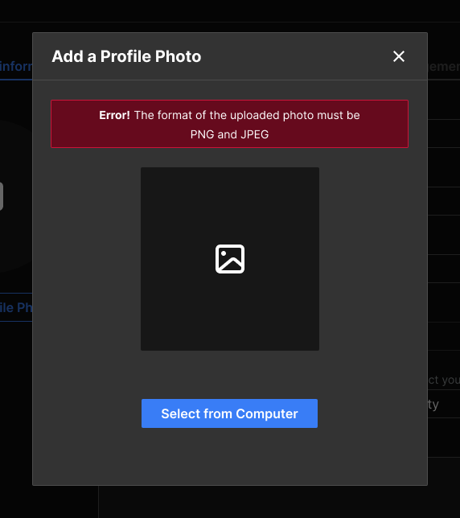 | 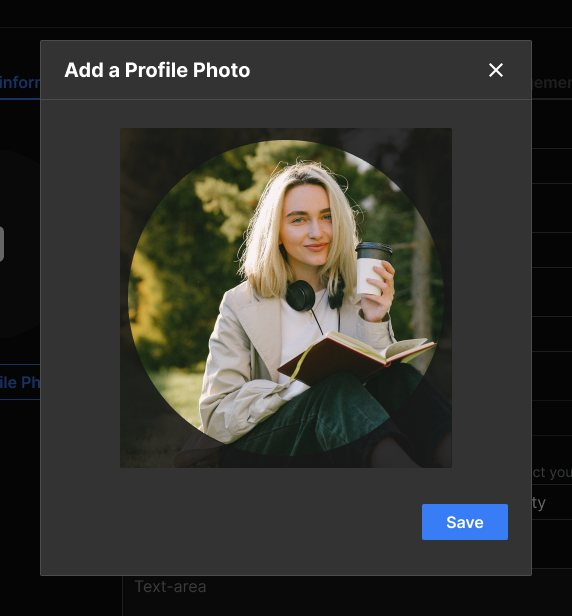 |

```tsx
'use client';

import { Button } from '@/shared/ui/button';
import { Modal } from '@/shared/ui/modal';

import css from './addProfilePhotoModal.module.scss';

const PHOTO_MODAL_WIDTH = 492;

type AddProfilePhotoModalProps = {
    open: boolean;
    error?: string;
    onClose: () => void;
};

export const AddProfilePhotoModal = ({
    open,
    error,
    onClose,
}: AddProfilePhotoModalProps): React.JSX.Element => {
    return (
        <Modal
            open={open}
            onClose={onClose}
            title="Add a Profile Photo"
            width={PHOTO_MODAL_WIDTH}
        >
            <div className={css.content}>
                {error && (
                    <p className={css.error}>
                        <b>Error!</b> {error}
                    </p>
                )}
                <div className={css.placeholder} />
                <Button>Select from Computer</Button>
            </div>
        </Modal>
    );
};
```

```scss
/* addProfilePhotoModal.module.scss */
.content {
    display: flex;
    flex-direction: column;
    align-items: center;
}

/* Блок ошибки из макета (компонент Alerts в Figma) */
.error {
    box-sizing: border-box;
    width: 100%;
    margin: 0 0 24px;
    padding: 6px 24px 5px;
    border: 1px solid #cc1439;
    border-radius: 2px;
    background-color: #660a1d;
    font-size: 14px;
    line-height: 24px;
    text-align: center;
}

.placeholder {
    width: 222px;
    height: 228px;
    margin-bottom: 60px;
    border-radius: 2px;
    background-color: #171717;
}
```

Размеры и цвета блока ошибки сняты из Figma (экран `Add a Profile Photo` с ошибкой, слой `Alerts`):

| Что                | Значение                                                    |
| ------------------ | ----------------------------------------------------------- |
| Фон                | `#660A1D`                                                   |
| Рамка              | 1px `#CC1439`, скругление 2px                               |
| Отступы            | 6px сверху, 24px по бокам, 5px снизу                        |
| Текст              | белый, 14px, высота строки 24px, по центру; `Error!` жирным |
| Отступ до заглушки | 24px                                                        |

-   `Add Photo` в создании поста такое же, но заголовок `Add Photo` и под основной кнопкой вторая: `<Button variant="outlined">Open Draft</Button>`.
-   Когда фото выбрано, вместо заглушки показывается превью, а внизу справа кнопка `Save`.

### 7. Шаги создания поста: своя шапка

Шапка не стандартная: стрелка «назад» слева, заголовок по центру, синяя кнопка `Next` или `Publish` справа, крестика нет. Фото прилегает к краям окна. Для этого `headerLeft`, `headerRight` и `noPadding`.

| Cropping (492)                     | Filters (972)                    | Publication (972)                        |
| ---------------------------------- | -------------------------------- | ---------------------------------------- |
| 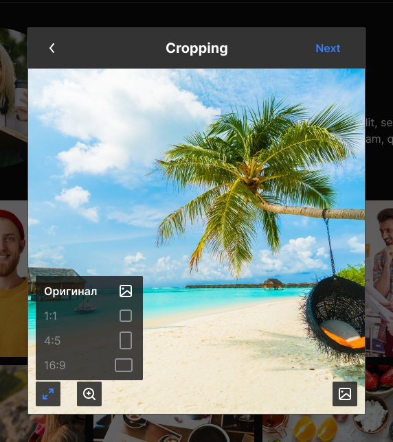 | 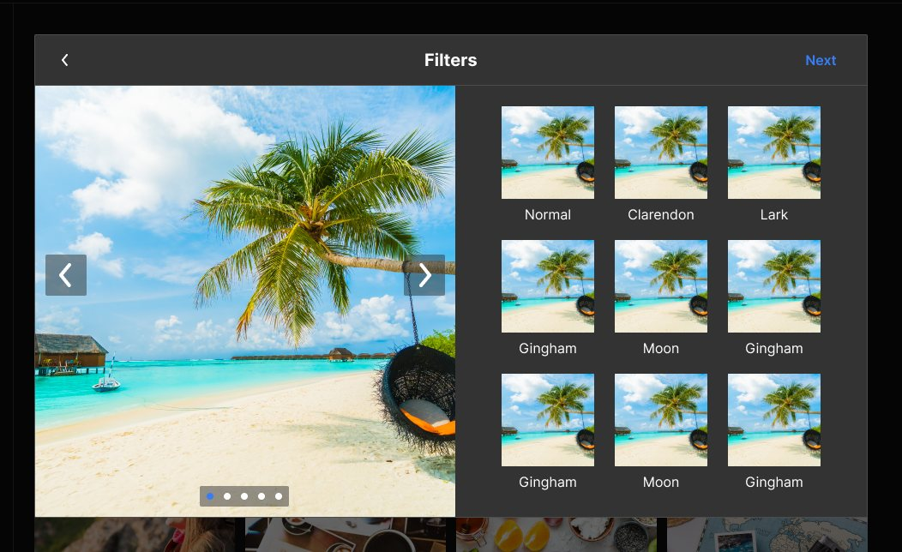 | 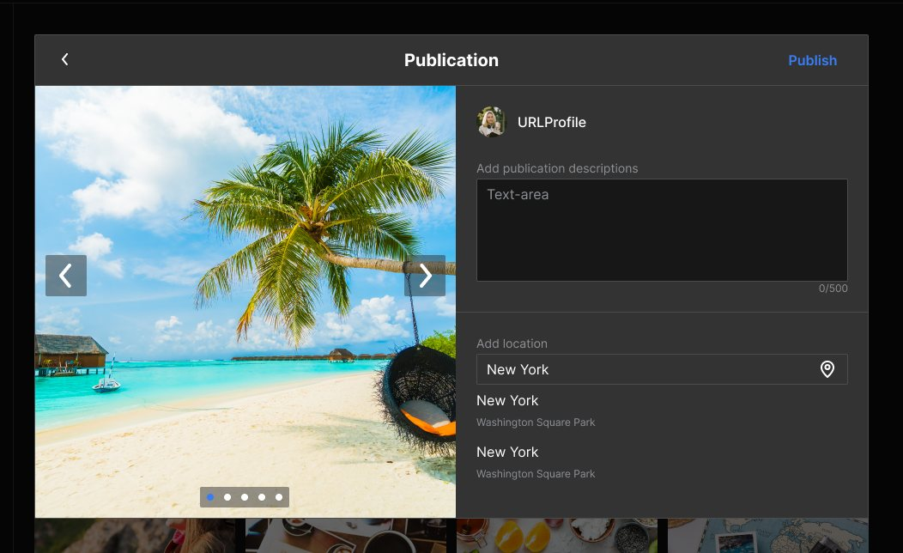 |

```tsx
'use client';

import { Button } from '@/shared/ui/button';
import { Modal } from '@/shared/ui/modal';

import { ArrowBackIcon } from './ArrowBackIcon';
import css from './croppingModal.module.scss';

const CROPPING_MODAL_WIDTH = 492;

type CroppingModalProps = {
    open: boolean;
    onBack: () => void;
    onNext: () => void;
    onClose: () => void;
};

export const CroppingModal = ({
    open,
    onBack,
    onNext,
    onClose,
}: CroppingModalProps): React.JSX.Element => {
    return (
        <Modal
            open={open}
            onClose={onClose}
            title="Cropping"
            width={CROPPING_MODAL_WIDTH}
            closeOnOverlayClick={false}
            noPadding
            headerLeft={
                <button
                    type="button"
                    className={css.back}
                    aria-label="Back"
                    onClick={onBack}
                >
                    <ArrowBackIcon />
                </button>
            }
            headerRight={
                <Button variant="text" className={css.next} onClick={onNext}>
                    Next
                </Button>
            }
        >
            {/* Фото и инструменты обрезки */}
            <CropArea />
        </Modal>
    );
};
```

```scss
/* croppingModal.module.scss */
.back {
    display: flex;
    padding: 0;
    border: none;
    background: none;
    color: #fff;
    cursor: pointer;
}

.next {
    padding: 0;
}
```

Подключение: `onClose` не закрывает окно, а открывает подтверждение `Close` из раздела 4.

```tsx
const [isCroppingOpen, setIsCroppingOpen] = useState(false);
const [isCloseConfirmOpen, setIsCloseConfirmOpen] = useState(false);

<CroppingModal
    open={isCroppingOpen}
    onBack={goToAddPhoto}
    onNext={goToFilters}
    onClose={() => setIsCloseConfirmOpen(true)}
/>;
```

-   `closeOnOverlayClick={false}`: случайный клик мимо окна не должен терять выбранные фото.
-   Escape всё равно вызывает `onClose`, а значит открывает подтверждение.
-   `Filters` и `Publication` такие же, отличаются шириной (972), заголовком и правой кнопкой (`Next` или `Publish`).

### 8. Редактирование поста

Ширина 972px. Шапка стандартная (`Edit Post` и крестик), но фото прилегает к краям окна. Для этого `noPadding`.

| Edit Post                            | Close Post (подтверждение поверх)      |
| ------------------------------------ | -------------------------------------- |
| 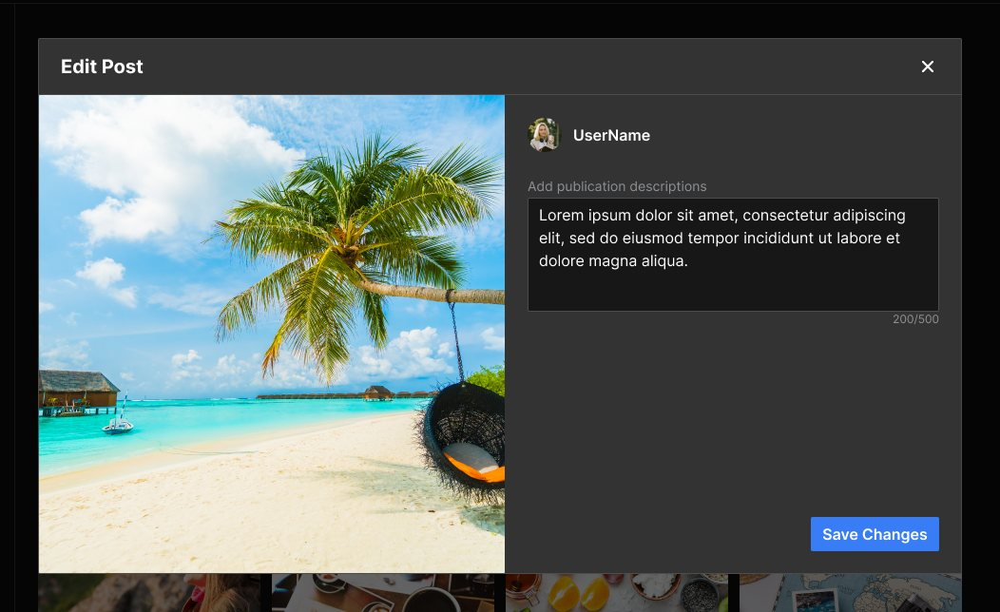 |  |

```tsx
'use client';

import { Modal } from '@/shared/ui/modal';

const EDIT_POST_MODAL_WIDTH = 972;

type EditPostModalProps = {
    open: boolean;
    onClose: () => void;
};

export const EditPostModal = ({
    open,
    onClose,
}: EditPostModalProps): React.JSX.Element => {
    return (
        <Modal
            open={open}
            onClose={onClose}
            title="Edit Post"
            width={EDIT_POST_MODAL_WIDTH}
            closeOnOverlayClick={false}
            noPadding
        >
            {/* Слева фото, справа описание (Textarea) и кнопка Save Changes */}
            <EditPostForm />
        </Modal>
    );
};
```

Крестик и Escape открывают подтверждение `Close Post` (раздел 2, ширина 486): `Yes` закрывает оба окна без сохранения, `No` возвращает к редактированию.

```tsx
const [isEditPostOpen, setIsEditPostOpen] = useState(false);
const [isClosePostOpen, setIsClosePostOpen] = useState(false);

const discardChanges = (): void => {
    setIsClosePostOpen(false);
    setIsEditPostOpen(false);
};

<EditPostModal open={isEditPostOpen} onClose={() => setIsClosePostOpen(true)} />;
```

### 9. Просмотр поста: крестик снаружи

Ширина 972px. Шапки нет, а крестик стоит **снаружи окна**, в правом верхнем углу экрана. Для этого `closeOutside` и окно без `title`.

| Пост (свой, чужой, с главной страницы) |
| -------------------------------------- |
| 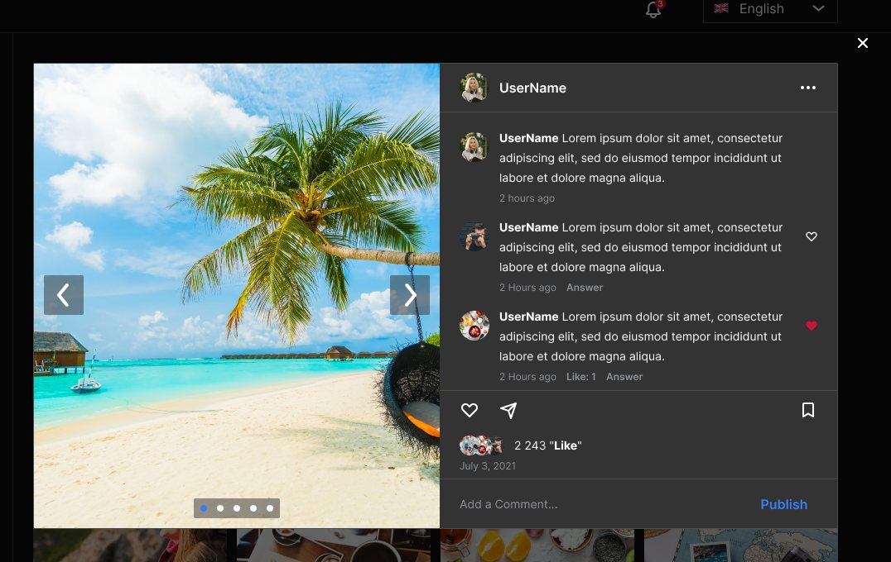        |

```tsx
'use client';

import { Modal } from '@/shared/ui/modal';

const POST_MODAL_WIDTH = 972;

type PostModalProps = {
    open: boolean;
    onClose: () => void;
};

export const PostModal = ({ open, onClose }: PostModalProps): React.JSX.Element => {
    return (
        <Modal open={open} onClose={onClose} width={POST_MODAL_WIDTH} closeOutside>
            {/* Слева карусель фото, справа автор, комментарии, лайки, поле комментария */}
            <PostView />
        </Modal>
    );
};
```

Это окно используется на экранах `My Post`, `Post Friend`, `Post User`, `main page/post`, `User profile (unauthorized user)/post`. Пункты `Delete Post` и `Edit Post` в меню `...` открывают окна из разделов 2 и 8.

## Сводная таблица

| Use-case                                             | `width` | Шапка                                               | Кнопки                               | `closeOnOverlayClick` |
| ---------------------------------------------------- | ------- | --------------------------------------------------- | ------------------------------------ | --------------------- |
| Email sent                                           | 378     | `title`                                             | `actions`                            | `true`                |
| Success, Error                                       | 378     | `title`                                             | `actions` + `Button fullWidth`       | `true`                |
| Log Out, Delete Photo                                | 438     | `title`                                             | `actions`                            | `true`                |
| Unfollow, Delete Following, Delete Post, Delete user | 378     | `title`                                             | `actions`                            | `true`                |
| Close Post                                           | 486     | `title`                                             | `actions`                            | `true`                |
| Ban user, Un-Ban user                                | 378     | `title`                                             | `actions` + `actionsAlign="between"` | `true`                |
| Create payment, Close                                | 378     | `title`                                             | `actions` + `actionsAlign="between"` | `true`                |
| Followers, Following, Likes                          | 644     | `title`                                             | нет                                  | `true`                |
| Add Photo, Add a Profile Photo                       | 492     | `title`                                             | в `children`                         | `true`                |
| Cropping                                             | 492     | `title` + `headerLeft` + `headerRight`, `noPadding` | `Next` в шапке                       | `false`               |
| Filters, Publication                                 | 972     | `title` + `headerLeft` + `headerRight`, `noPadding` | `Next` / `Publish` в шапке           | `false`               |
| Edit Post                                            | 972     | `title`, `noPadding`                                | в `children`                         | `false`               |
| Просмотр поста                                       | 972     | без `title`, `closeOutside`                         | нет                                  | `true`                |

## Стили окна

| Часть           | Как выглядит                                                                    |
| --------------- | ------------------------------------------------------------------------------- |
| Фон под окном   | чёрный с прозрачностью 60% (`::backdrop`), как в макете                         |
| Окно            | фон `#333333`, рамка 1px `#4C4C4C`, скругление 2px                              |
| Шапка           | отступы 12px 24px, линия снизу `#4C4C4C`                                        |
| Своя шапка      | три колонки: `headerLeft`, заголовок по центру, `headerRight`                   |
| Заголовок       | 20px, жирный, высота строки 36px                                                |
| Крестик         | белый, при наведении `#8D9094`, при фокусе с клавиатуры синяя обводка `#397DF6` |
| Крестик снаружи | `position: fixed`, 60px сверху и 22px справа, как в макете                      |
| Тело            | отступы 30px 24px 36px, с `noPadding` без отступов                              |
| Ряд `actions`   | прижат вправо, между кнопками 24px; с `between` разнесён по краям               |

На узком экране окно не шире `100vw - 32px`, по 16px отступа с каждой стороны.

Пока открыто хотя бы одно окно, страница под ним не прокручивается. Это правило лежит в `app/globals.scss`:

```scss
/* Пока открыто модальное окно, страница под ним не прокручивается */
html:has(dialog:modal) {
    overflow: hidden;
}
```

Правило стоит на `html`, а не на `body`. В `globals.scss` у `html` задан `overflow-x: hidden`, поэтому прокручивается именно `html`, и `overflow: hidden` на `body` скролл не остановит.

## Использование в Next.js

У компонента стоит `'use client'`, потому что внутри есть `useRef` и `useEffect`. Родитель, который хранит `open` в `useState`, тоже должен быть клиентским.

## Ограничения текущего API

-   Шапка бывает двух видов: стандартная (заголовок слева, крестик справа) и своя (заголовок по центру между `headerLeft` и `headerRight`). Другие раскладки шапки рисуй в окне без `title`.
-   Ряд `actions` умеет только `end` и `between`.
-   Нет анимации появления.

Если понадобится что-то сверх этого во многих местах, это отдельная доработка общего компонента, а не локальный хак в фиче.
